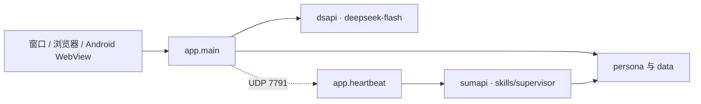

# Miracii
A Self-made Chat Robot with Custom Persona and Upgrading Memory Construction

本地人格伴侣：**v0.0.1（测试）**。说话模型负责对话；监督模型负责巩固时钟、印象和知识候审。窗口是 RAM，文件是磁盘。

## 工作流

两个进程。网页请求只负责这一句；心跳负责她还在过的时间。



对话：`POST /api/chat` 拼 system，只附上尚未 STM 的原文，流式回复写入 sqlite 与 `data/transcripts/`。已巩固的句子留在页面上，不再退回说话模型。

巩固：心跳睡到下一截止点。新对话用 UDP 把 5 分钟窗口推后，不在这条链上生成回复。到期才叫监督。

| phase | 何时 | 落盘 |
|---|---|---|
| stm | 最后一句后 `stm_minutes`（默认 5）仍无新对话 | `memory/working.txt` |
| routine | 该轮 stm 之后 `routine_minutes`（默认 30），只做一次 | `memory/impression/YYYY-MM-DD.txt`，working 换成这段印象 |
| daily | 错过的日界（默认 23:00 后） | 当日印象抄入 `episodic/YYYY-MM-DD.txt`；`learn` 写入 semantic / calendar |
| weekly | 错过的周日夜 | `kind=pattern` 进 `learn_queue/pending.jsonl` |

监督只回 JSON：`speak`、`impression`、`working_note`、`learn`、`tasks`。`stm` / `routine` 丢弃 `learn`。`profile` 与 `lore/` 不由监督改写。sumapi 失败时用本地 gist，不写空占位。

主动开口：`speak=true` 且通过 quiet、每日 quota、未在对话中，再调说话模型，经 `/api/inbox` 进页面。

说话模型每轮可见：

1. 身份四件套 + `lore/always.txt` + `memory/working.txt`
2. 命中的 semantic（keys / 人名）
3. 问到「那次」或 keys 命中时的 impression / episodic
4. 命中的 lore：`digest` 靠 `keys`；`story` 还要意图词或 `also`
5. 问到钟点、日期、日历时才注入【此刻】与 `calendar.txt`

## 仓库

```text
app/                  运行时
  __main__.py         python -m app
  launch.py           窗口、HTTP、心跳线程、--web / --lan
  main.py             FastAPI
  llm.py              dsapi，模型 deepseek-flash
  persona.py          拼 system
  lore.py             设定检索。form 只认 digest、story
  recall.py           记忆检索：semantic、impression、episodic
  when.py             按句触发时钟与日历
  clock.py            巩固时钟与落盘
  heartbeat.py        睡到截止点，调监督，执行 JSON
  supervisor.py       packet、默认决策、采纳 learn
  wake.py             本机 UDP 7791
  keeper.py           盯保存日志；成长摘要尚未自动跑
  notify.py           主动开口时：Windows 系统通知。窗口在前台则不提醒（浮动弹窗默认关）
  files.py            transcripts、控制台可读文件
  db.py               data/chat.db
  keys.py             读 APIkeys.txt
  media.py            聊天图片
  static/             页面：index.html、app.js、app.css、console.js
persona/
  active.txt          当前人格 id
  _template/          空人格骨架
  holmes-test/        公开测试人格
  miracii/            主人格。被 .gitignore 排除，不在远程仓库
skills/               给监督与检索读的规程，不是模型自己调的工具
  supervisor/SKILL.md 监督的 system
  supervisor/reference.md  packet 与文件对照
  clock/SKILL.md      何时注入时间；执行在 app/when.py
docs/                 设计笔记，不进提示
data/                 运行产生。库、原文、日志默认不入库
packaging/            Android WebView、桌面启动脚本
requirements.txt      fastapi、uvicorn、httpx、pywebview
APIkeys.txt           不入库。一行 provider=alias=secret
```

## 人格目录

`persona/<id>/`。`notes.txt` 只给人看，不进模型。

| 路径 | 含义 |
|---|---|
| `profile.txt` | 名字、对方、关系、节奏、动机、禁忌。每轮都在 |
| `voice_lines.txt` | 口癖。孤立原话，不是对白 |
| `examples.txt` | 对答示范 |
| `forbidden_style.txt` | 禁句 |
| `source.txt` | 材料来源说明（测试人格） |
| `secondary/pending.txt` | 尚未并入主档案的成长条目。非空则附在 system 末尾 |
| `lore/always.txt` | 短事实。每轮都在 |
| `lore/entries/*.txt` | 词条。`form: digest`。`keys` 命中即注入正文 |
| `lore/entries/stories/*.txt` | 一场细稿。`form: story`。`also` 为该场独有词；或 `keys` 加上「还记得 / 那次」等意图词。多篇同时命中且无独有词时不注入 |
| `lore/notes.txt` | 词条格式说明 |
| `memory/working.txt` | 短期工作台。stm 写入，routine 后换成印象 |
| `memory/impression/YYYY-MM-DD.txt` | 一场印象：场面、气氛、keys。不是对白切片 |
| `memory/episodic/YYYY-MM-DD.txt` | 当日印象的一日一条。`event.txt` 是字段样例 |
| `memory/semantic/facts.txt` | `对象 \| 事实 \| 日期 \| keys` |
| `memory/semantic/people.txt` | `名字 \| 关系或细节 \| 日期` |
| `memory/calendar.txt` | `YYYY-MM-DD [HH:MM] 标题`。问到日历才注入近两周 |
| `memory/schedule.txt` | 时区、quiet、stm/routine 分钟、每日开口配额、番茄钟时长参考。不是作息表 |
| `memory/learn_queue/pending.jsonl` | pattern、低置信、改设定。确认前不进 lore |
| `memory/notes.txt` | 记忆分层说明 |

`form` 写成其他值时，检索按 `digest` 处理。`constant: yes` 的词条不靠关键词，每轮注入。

## 运行时文件

| 路径 | 含义 |
|---|---|
| `data/chat.db` | 页面消息。不入库 |
| `data/transcripts/<id>/YYYY-MM-DD.txt` | 原文。不删，可重摘要 |
| `data/media/` | 聊天图片 |
| `data/clock.json` | 巩固时钟：stm 是否完成、routine 是否做过、已巩固到哪条消息 |
| `data/supervisor.jsonl` | 一次 tick 一行：packet、decision、`source`（`sumapi` / `rule` / `sumapi-fail`）、`applied` |
| `data/heartbeat.log` | tick 摘要 |
| `data/keeper.log` | 原文保存记录 |
| `docs/HOW_PERSONA_RUNS.txt` | 四层记忆与论文对照 |
| `docs/CONSOLIDATION.txt` | 巩固时间轴 |
| `docs/HEARTBEAT.txt` | 为何要独立心跳 |
| `docs/AGENT.txt` | 主动开口与以后的工具边界 |
| `docs/NOTIFY.txt` | 主动开口的桌面提醒：焦点规则、两层实现、开关与测法 |
| `docs/changes/` | 改动登记：每个行为改动一条记录，跨 agent 复核（规矩见 `changes/README.txt`） |
| `packaging/android/` | WebView 客户端。模型仍在电脑上 |
| `packaging/desktop/` | 窗口启动脚本 |

密钥：`dsapi` 且 alias 含 `Zero` 给说话；`sumapi` 给监督。

## 接口

本机默认 `127.0.0.1:7788`。无鉴权。

| 方法 | 路径 | 作用 |
|---|---|---|
| GET | `/` | 页面 |
| GET | `/api/health` | 存活 |
| GET | `/api/meta` | 当前人格、模型名、人格列表 |
| POST | `/api/persona` | 切换 `persona/active.txt` |
| GET | `/api/history` | 页面消息 |
| DELETE | `/api/history` | 只撤回尚未巩固的句子 |
| GET | `/api/inbox` | 心跳主动开口的新消息 |
| POST | `/api/chat` | SSE：user / token / done |
| GET | `/api/media/<persona>/<name>` | 图片 |
| GET | `/api/files` | 控制台文件列表 |
| GET | `/api/files/content` | 沙箱内文本。不含 `APIkeys.txt` |

## 入口

| 命令 | 作用 |
|---|---|
| `python -m app` | 窗口 + HTTP + 心跳，同一进程。从终端启动时终端仍在 |
| `Miracii.bat` | 同上，经 `pythonw`，只留聊天窗口 |
| `python -m app --web` | 只开 HTTP |
| `python -m app --lan --web` | 绑定 `0.0.0.0`。`Miracii-lan.bat` 相同。手机用打印出的局域网地址 |
| `python -m app --no-heartbeat` | 不启动巩固 |
| `python -m app.heartbeat` | 单独心跳。与上表第一行同时开时会抢 UDP 7791 |
| `python -m app.notify --force "文本"` | 只测桌面提醒这一下，忽略焦点与 `notify:` 开关 |

依赖：`pip install -r requirements.txt`。Android 包见 `packaging/android/README.md`。

运行时用**项目 venv**：`Miracii.bat` 优先调 `.venv\Scripts\pythonw.exe`，找不到才回退 PATH 上的
`pythonw`。所以 `pip install -r requirements.txt` 要装进 `.venv`，不要装到系统 Python——两套解释器
并存时「装了依赖却开不出窗口」就是这么来的。

测试：`python -m unittest discover -s tests -t .`。仓库自带的 `githooks/pre-commit` 会在每次提交前
跑同一套测试（不通过就中止本次提交；单次跳过用 `git commit --no-verify`）。每个克隆启用一次：

```powershell
git config core.hooksPath githooks
```

改动登记：动应用行为、数据格式、接口、启动方式或依赖时，在 `docs/changes/` 新增一条记录
（用 `_TEMPLATE.txt` 起头），提交信息里写清文件名。规矩见 `docs/changes/README.txt`。

## 版本

**0.0.1（测试）**。协议、文件格式、封装方式都会变。
